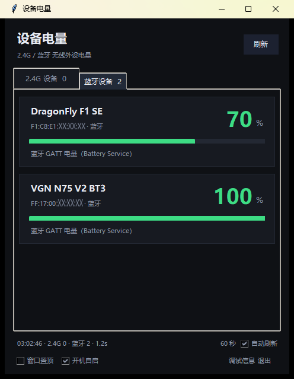

# 设备电量

Windows 上查看无线外设电量的小工具：**2.4G 接收器**和**蓝牙（BLE）**两条路都能读，
面板分「2.4G 设备 / 蓝牙设备」两个选项卡，任务栏还有圆环图标。

纯 Python 标准库 + ctypes：不用 hidapi、不用 pystray、不用 Pillow、不用 winrt。



## 功能

- **两个选项卡**
  - **2.4G 设备**：走接收器的厂商 HID 协议（BY Tech/Pulsar、VGN 键盘、ATK/VXE、罗技 HID++）。
  - **蓝牙设备**：走 GATT Battery Service（`0x180F` / `0x2A19`），Windows 自己也是这么读的。
- **托盘圆环**：每个设备一个 16×16 图标，外圈是电量进度、中间是百分比数字；
  左键刷新、右键打开面板；悬停显示「设备名 99%」。
- 大号百分比 + 颜色分级进度条（≥60 绿 / 30–59 黄 / <30 红），蓝牙卡片显示 MAC 地址。
- 自动刷新（15 秒 ~ 5 分钟）、窗口置顶、开机自启（隐藏启动）。
- `--dump` 调试模式：列出所有 HID 接口的 UsagePage、报告长度、Feature Report 原始字节。


## 实测

| 设备 | 连接方式 | 地址 / VID:PID | 结果 |
|---|---|---|---|
| VGN DragonFly F1 SE | 蓝牙 BLE | `F1:C8:E1:XX:XX:XX` | ✅ 70% |
| VGN N75 V2 | 蓝牙 BLE | `FF:17:00:XX:XX:XX` | ✅ 100% |
| VGN DragonFly F1 SE | 2.4G 接收器 | `3554:FB50` | ✅ 70% / 3.98 V |
| VGN N75 V2 | 2.4G 接收器 | `391D:2A01` | ✅ 99% |

> 表里和截图里的 MAC 地址后三段用 `XX` 代替了（前三段是厂商 OUI，公开信息）。
> VID:PID 是型号标识，同型号设备都一样，所以保留原样。

> 已配对但没连上的设备不会出现在蓝牙选项卡里（比如同时配过的 MINI 60 HE PRO-1）。

## 蓝牙电量是怎么读的

Windows 把 BLE 外设的每个 GATT 服务挂成独立设备接口：

```
\\?\bthledevice#{0000180f-...}_dev_vid&02258a_pid&0040_..._ff1700xxxxxx#...#{6e3bb679-...}
```

流程（全是 Win32 API，`bluetoothapis.dll`）：

1. 用 SetupAPI 枚举 `GUID_GATT_SERVICE`（`{6e3bb679-4372-40c8-9eaa-4509df260cd8}`）接口，
   挑出路径里带 Battery 服务 UUID 的那些，设备地址就在路径里；
2. `CreateFile` 打开这个**服务句柄**；
3. `BluetoothGATTGetServices` → `BluetoothGATTGetCharacteristics` → 找到 `0x2A19`；
4. `BluetoothGATTGetCharacteristicValue` 读出 1 字节百分比。

> 文档里这个函数的第一个参数写的是「Handle to the service」，一开始拿设备句柄去调，
> 一直返回 `ERROR_ACCESS_DENIED`；换成服务句柄、并且 service 结构也来自这个句柄的
> `BluetoothGATTGetServices`，才返回 `ERROR_MORE_DATA` + 正确长度。

设备名不在 GATT 里，从注册表 `HKLM\SYSTEM\CurrentControlSet\Services\BTHPORT\Parameters\Devices\<地址>\Name`
读（UTF-8 字节）。

**只显示「已连接」的设备**：Windows 会为**已配对**的设备保留 GATT 缓存，如果只看服务接口，
没连上的设备也会列出来（而且读到的是上次的旧电量）。所以蓝牙那一步会先用
`bt_connected.ps1`（PowerShell + WinRT，0.5 秒）问一次「哪些设备现在是 Connected」，
再只读这些设备的电量。PowerShell 不可用时退回「列出全部已配对设备」。

> 实测发现 GATT 句柄在解释器退出、GC 时会偶发访问冲突（`0xC0000005`），
> 所以蓝牙读取放在**子进程**里跑，读完直接 `os._exit(0)`，崩了也只影响子进程。

## 运行

```bash
python app.py             # 纯托盘（只在任务栏显示圆环）
python app.py --show      # 打开面板 + 托盘
python app.py --once      # 命令行读一次（分 2.4G / 蓝牙两段打印）
python app.py --json      # JSON
python app.py --dump      # 调试：列出所有 HID 接口
```

也可以双击 `启动.cmd`（等同 `--show`）。关闭面板只是缩到托盘，
彻底退出点面板右下角的「退出」。

环境要求：Windows 10/11，Python 3.10+（官网安装包自带 tkinter）。

## 托盘

- 一个设备一个圆环图标，最多 4 个；蓝牙设备排在前面。
- 图标颜色跟面板一致，充电时数字变琥珀色（蓝牙协议里没有充电位，所以不显示）。
- **左键**刷新、**右键**打开面板。
- Windows 11 默认把新图标收进「^」溢出区，第一次用可能需要拖到任务栏上固定。
- 资源管理器重启后会自动重新注册。

## 给新设备加协议

1. `python app.py --dump` 看接口：记下 `usage=xxxx/xxxx`、报告长度、Feature Report 原始字节。
2. 2.4G 厂商通道（`0xFF00` 以上）按「单字节命令 + 状态帧」试：
   BY Tech 是发 `08 04 00 ... 校验`；VGN 键盘是发 `13 4A`，回 `13 4A 01 00 02 <电量> <flags>`。
3. 蓝牙设备如果支持标准 Battery Service，面板会自动认出来，不用写代码；
   想加自定义 GATT 特征，改 `btwin.py` 里的 `BATTERY_SERVICE` / `BATTERY_LEVEL_CHAR`。
4. 2.4G 设备也能用 `devices.json` 手动标定（Report ID + 命令 + 电量下标）。

## 已知限制

- **同一台设备不会同时出现在两栏**：切到蓝牙，2.4G 那栏就空；切回 2.4G，蓝牙那栏就空——
  已配对但没连上的设备不会因为 GATT 缓存而残留。
- 蓝牙必须处于「已连接」状态；断开后卡片会消失（不会再显示上次的缓存值）。
- 蓝牙只读标准 Battery Service；不支持该服务的设备（少数私有协议）读不到。
- 蓝牙连接状态依赖 PowerShell 5.1（Windows 自带）：它返回空数组就表示「一台都没连」；
  查询本身失败时也不显示设备（宁缺毋滥，避免出现幽灵设备）。
- **托盘需要正常权限**：Windows 的 UIPI 会拒绝低完整性进程注册托盘图标，
  这时程序会自动把面板显示出来并提示「托盘不可用：请从资源管理器启动」。
- 厂商协议是逐设备逆向的，只读查询，不改 DPI、灯光等任何设置。

## 文件结构

| 文件 | 说明 |
|---|---|
| `hidwin.py` | HID 底层：SetupAPI 枚举、Feature/Output/Input Report、值能力解析 |
| `battery.py` | 2.4G 电量策略：标准 HID / VGN 键盘 / BY Tech / ATK / 罗技 HID++ / 手动标定 |
| `btwin.py` | 蓝牙电量：GATT 接口枚举、Battery Service 读取、名称查询（也可 `--json` 单独跑） |
| `bt_connected.ps1` | 用 PowerShell + WinRT 查「哪些 BLE 设备现在是已连接」（过滤离线设备） |
| `tray.py` | 托盘图标：GDI 画圆环 HICON、Shell_NotifyIcon、左右键消息 |
| `app.py` | tkinter 面板（两个选项卡）+ 命令行 |
| `startup.py` | 开机自启（`HKCU\...\Run`） |
| `devices.example.json` | 2.4G 手动标定模板 |

## 打包成 exe（可选）

```bash
pip install pyinstaller
pyinstaller -w -n 设备电量 app.py
```

注意：蓝牙读取依赖同目录的 `btwin.py`（子进程调用），打包时需要把它作为数据文件带上，
或者把 `_collect_bluetooth()` 改成进程内调用（会重新暴露退出崩溃的问题）。
